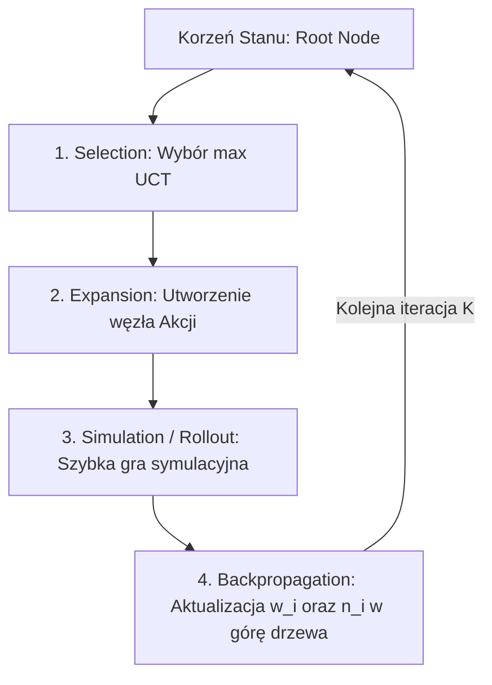

# Dokumentacja Techniczna: Monte Carlo Tree Search – MCTS (`Uno/AIPlayers/MonteCarloTreeSearch`)

## 1. Formalne Podstawy Teoretyczne Algorytmu MCTS

Algorytm **Przeszukiwania Drzewa Gry metodą Monte Carlo (Monte Carlo Tree Search - MCTS)** w zaimplementowanym systemie stanowi najbardziej zaawansowane bezmodelowe podejście do sekwencyjnego podejmowania decyzji. 

W przeciwieństwie do statycznych klasyfikatorów (C4.5, Naive Bayes), MCTS symuluje przyszłe stany gry (*lookahead*), rozwiązując problem wyboru akcji jako optymalny balans pomiędzy **eksploatacją** (*exploitation*) znanych wygrywających ruchów a **eksploracją** (*exploration*) ruchów rzadko badanych.

---

## 2. Formuła UCT (Upper Confidence Bound applied to Trees)

Wyborowi węzła potomnego w fazie selekcji patronuje wzór **UCT**, stanowiący adaptację algorytmu wielorękiego bandyty (Multi-Armed Bandit / UCB1) do struktur drzewiastych:

$$UCT_i = \bar{X}_i + c \cdot \sqrt{\frac{\ln N}{n_i}} = \frac{w_i}{n_i} + c \cdot \sqrt{\frac{\ln N}{n_i}}$$

gdzie:
- $w_i$ – skumulowana liczba wygranych symulacji przechodzących przez węzeł $i$ (`node.get_wins()`).
- $n_i$ – liczba odwiedzin węzła $i$ (`node.get_visits()`).
- $N$ – całkowita liczba odwiedzin węzła rodzica ($N = \sum_j n_j$).
- $c$ – współczynnik eksploracji (`c_param`, domyślnie $c = 2$), kontrolujący wagę pierwiastka niepewności.

---

## 3. Przebieg Algorytmu – Cztery Fazy MCTS

Struktura pętli wykonawczej w metodzie `move()` agenta `MCTSBot`:



### 3.1. Selection (Selekcja)
Agent rozpoczyna od bieżącego korzenia `root`. Węzeł potomny o najwyższym wskaźniku UCT jest schodkowo wybierany za pomocą metody `get_highest_ucb_child()`:

$$\hat{i} = \arg\max_{i \in \text{Children}} UCT_i$$

Jeśli istnieją nieodwiedzone węzły ($n_i = 0$), przypisywana jest im wartość UCT $+ \infty$, gwarantująca ich zbadanie przynajmniej raz.

---

### 3.2. Expansion (Ekspansja)
W przypadku napotkania węzła liścia, który nie reprezentuje stanu końcowego gry, generowana jest lista legalnych akcji $A = \text{all\_valid\_actions}()$. Dla każdej akcji rozwijany jest nowy węzeł potomny `Node(parent, action)`.

---

### 3.3. Simulation / Rollout (`Simulation.py`)
Z wybranego węzła uruchamiana jest szybka symulacja losowa rozgrywki aż do wyłonienia zwycięzcy.
- Obiekt `Simulation` tworzy głęboką kopię stanu gry.
- Gracze symulacyjni podejmują szybkie ruchy losowe lub heurystyczne.
- Wynik symulacji wynosi $r = 1$ w przypadku wygranej agenta MCTS lub $r = 0$ w przypadku przegranej.

---

### 3.4. Backpropagation (Propagacja Wsteczna)
Wynik $r \in \{0, 1\}$ jest rekurencyjnie przekazywany w górę drzewa od węzła liścia do korzenia:

$$n_k \leftarrow n_k + 1$$
$$w_k \leftarrow w_k + r \quad \forall k \in \text{PathToRoot}$$

Napisana metoda `backpropagation()`:
```python
def backpropagation(self, node, result):
    if node is not None:
        node.set_wins(node.get_wins() + result)
        node.set_visits(node.get_visits() + 1)
        self.backpropagation(node.get_parent(), result)
```

---

## 4. Wyzwania w Grze z Niepełną Informacją (Imperfect Information)

Uno jest grą z zakrytą kartą przeciwnika i zakrytą talią. W klasycznej teorii MCTS stosuje się **Determinizację** (*Information Set MCTS*), polegającą na próbkowaniu możliwych układów kart w rękach rywali zgodnie z rozkładem jednostajnym i przeprowadzaniu symulacji na tak uzupełnionych światach.

- **Złożoność Czasowa:** $O(K \cdot L)$, gdzie $K$ to liczba symulacji (`num_of_simulations`), a $L$ to głębokość symulowanego rolloutu.
- **Wyniki:** MCTS osiąga najwyższy wskaźnik wygranych (*Win Rate*) spośród wszystkich poddanych ewaluacji botów, eliminując słabości statycznych klasyfikatorów.
