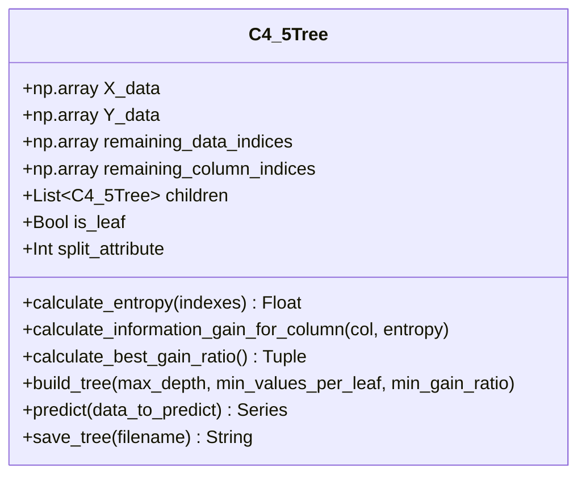

# Dokumentacja Techniczna: Drzewa Decyzyjne i Zespoły (`Uno/DecisionTrees`)

## 1. Matematyczne Podstawy Teoretyczne

Katalog `Uno/DecisionTrees` zawiera własne (zbudowane od podstaw bez użycia bibliotek scikit-learn) implementacje algorytmów uczenia nadzorowanego bazujących na drzewach decyzyjnych: **ID3**, **C4.5** oraz ich zespołów (**Random Forest** i **Bagging Ensembles**).

### 1.1. Entropia Shannona
Miarą losowości i niepewności rozkładu etykiet klas $Y$ w zbiorze danych $S$ jest entropia Shannona:

$$H(S) = - \sum_{i=1}^{K} p_i \log_2 (p_i)$$

gdzie $p_i$ jest proporcją występowania klasy $i$ w zbiorze $S$ ($p_i = \frac{|S_i|}{|S|}$).

---

### 1.2. Zysk Informacyjny (*Information Gain* – Algorytm ID3)
Dla wskazanego atrybutu $A$ o dyskretnych wartościach $v \in \text{Values}(A)$, podział zbioru $S$ na podzbiory $S_v$ wyznacza entropię warunkową:

$$H(S \mid A) = \sum_{v \in \text{Values}(A)} \frac{|S_v|}{|S|} H(S_v)$$

Zysk informacyjny $IG(S, A)$ określany w algorytmie ID3 wynosi:

$$IG(S, A) = H(S) - H(S \mid A)$$

---

### 1.3. Współczynnik Zysku (*Gain Ratio* – Algorytm C4.5)
Algorytm ID3 posiada tendencję do faworyzowania atrybutów o dużej liczbie unikalnych wartości. Algorytm C4.5 rozwiązuje ten problem poprzez wprowadzenie kary w postaci **Informacji Podziału** (*Split Information*):

$$SplitInfo_A(S) = - \sum_{v \in \text{Values}(A)} \frac{|S_v|}{|S|} \log_2 \left( \frac{|S_v|}{|S|} \right)$$

Ostateczny kryterium wyboru podziału w C4.5 stanowi **Współczynnik Zysku** (*Gain Ratio*):

$$GainRatio(S, A) = \frac{IG(S, A)}{SplitInfo_A(S)}$$

---

## 2. Architektura Klas i Budowa Algorytmu C4.5 (`C4_5Tree.py`)

Klasa `C4_5Tree` reprezentuje węzeł w drzewie decyzyjnym z pełnym wsparciem indeksowania tablic NumPy bez konieczności kopiowania dużych ramek danych w pamięci RAM.

### 2.1. Algorytm Rekurencyjnego Budowania Drzewa (`build_tree`)

Warunki stopu podziału węzła:
1. **Maksymalna Głębokość (`max_depth`):** Osiągnięcie limitu głębokości $d = \text{node\_depth}$.
2. **Minimalny Współczynnik Zysku (`min_gain_ratio`):** $\max_A GainRatio(S, A) < \text{threshold}$.
3. **Czystość Węzła (*Pure Node*):** $|\text{unique}(Y[S])| = 1$.
4. **Liczność Liścia (`min_values_per_leaf`):** Liczba próbek przypadających na liść jest mniejsza niż zadan progiem.

---

## 3. Zespoły Klasyfikatorów i Serializacja Models (`Models/`)

### 3.1. Zespół Baggingu (`baggingCreator.py` / `C4_5BaggingEnsemble.py`)
Metoda Baggingu (*Bootstrap Aggregating*) tworzy $M$ niezależnych drzew C4.5 wyszkolonych na próbach z powtórzeniami pobranych ze zbioru treningowego. 

Finalna decyzja zespołu wyznaczana jest w drodze **Głosowania Większościowego** (*Majority Voting*):

$$\hat{y} = \arg\max_{c \in Y} \sum_{m=1}^{M} \mathbb{I}(T_m(x) = c)$$

### 3.2. Serializacja Modułu
Zbudowane i przycięte drzewa są poddawane czyszczeniu danych surowych (`drop_data()`) celem odchudzenia rozmiaru pliku i serializowane do plików `.pkl` za pomocą modułu `pickle`.

---

## 4. Krytyczna Analiza Ograniczeń (Krytyka Metodologiczna)

Mimo że C4.5 i zespoły drzew decyzyjnych stanowią podstawę uczenia nadzorowanego na danych tabelarycznych, ich zastosowanie w środowisku gry Uno ujawnia wyraźne ograniczenia teoretyczne:

1. **Brak Kontekstu Sekwencyjnego:** Drzewo traktuje każdą turę jako niezależną próbkę statyczną, nie biorąc pod uwagę ciągłości strategii ani sekwencji zagrań przeciwników.
2. **Problem Etykietowania (Labeling Bias):** Jakość wygenerowanego drzewa jest bezpośrednio ograniczona jakością bota heurystycznego, z którego pozyskano dane treningowe. Drzewo uczy się odtwarzać błędy bota regułowego.
3. **Ślepota na Horyzont Gry (*Lookahead Blindness*):** Brak możliwości przeprowadzenia symulacji w przód (*rollout*) sprawia, że C4.5 nie potrafi przewidzieć konsekwencji zmuszenia przeciwnika do dociągnięcia kart w perspektywie kilku kolejnych tur.
