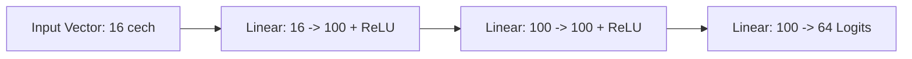

# Dokumentacja Techniczna: Sieci Neuronowe i Uczenie z Naśladownictwa (`Uno/NeuralNetwork`)

## 1. Paradygmat Uczenia z Naśladownictwa (*Imitation Learning*)

Moduł `Uno/NeuralNetwork` realizuje podejście oparte na **Uczeniu z Naśladownictwa (Imitation Learning)**, określanym w literaturze również jako **Behavioral Cloning (Klonowanie Behawioralne)**.

W tym paradygmacie agent nie uczy się poprzez próbkowanie nagród ze środowiska (jak w RL), lecz pobiera parę $(\text{stan } s, \text{akcja } a)$ pozyskaną z logów wygranych rozgrywek przeprowadzonych przez silne algorytmy (np. MCTS / expert heuristics). Zagadnienie gry sprowadzane jest do klasyfikacji wieloklasowej w uczeniu nadzorowanym:

$$\mathcal{D}_{train} = \big\{ (s^{(k)}, a^{(k)}) \big\}_{k=1}^{M}$$

---

## 2. Architektura Modelu PyTorch (`NNModel` / `ModelWithLabels.py`)

Model sieci neuronowej jest zaimplementowany jako **Wielowarstwowy Perceptron (MLP - Multi-Layer Perceptron)** w oparciu o bibliotekę **PyTorch** (`torch.nn.Module`).



### 2.1. Formuła Matematyczna Warstw
Dla wektora wejściowego cech stanu $x \in \mathbb{R}^{16}$:

1. **Pierwsza warstwa ukryta (FC1):**
   $$h_1 = \text{ReLU}(W_1 x + b_1), \quad W_1 \in \mathbb{R}^{100 \times 16}, \; b_1 \in \mathbb{R}^{100}$$

2. **Druga warstwa ukryta (FC2):**
   $$h_2 = \text{ReLU}(W_2 h_1 + b_2), \quad W_2 \in \mathbb{R}^{100 \times 100}, \; b_2 \in \mathbb{R}^{100}$$

3. **Warstwa wyjściowa (Output Logits):**
   $$\hat{y} = W_3 h_2 + b_3, \quad W_3 \in \mathbb{R}^{64 \times 100}, \; b_3 \in \mathbb{R}^{64}$$

Funkcja aktywacji **ReLU** (*Rectified Linear Unit*) zdefiniowana jest jako:
$$\text{ReLU}(z) = \max(0, z)$$

---

## 3. Logika Decyzyjna i Maskowanie Akcji (`SimpleNNBot.py`)

Samo wygenerowanie logitów przez sieć neuronową nie gwarantuje, że najwyżej oceniona karta jest w danym momencie **legalna do zagrania** według zasad Uno. Z tego powodu `SimpleNNBot` implementuje mechanizm **Maskowania Akcji Legalnych (*Action Masking*)**:

```python
def move(self, first_card_taken=None, game=None):
    valid_cards: list = self.valid_cards(first_card_taken)
    if len(valid_cards) == 1 and not isinstance(valid_cards[0], ColorCard):
        return valid_cards[0]

    predicted_values = self.predict_card() # Pobranie sortowanych logitów wyjściowych
    for values in predicted_values:
        card_str = self.model.get_labels()["card_played"][int(values[0])]
        card = self.create_card_instance(...)

        # Wybór pierwszej karty z priorytetu sieci, która jest w zbiorze legalnych
        if card in valid_cards:
            return card

    return random.choice(valid_cards)
```

- **Algorytm Maskowania:**
  1. Pobranie z sieci wektora logitów $\hat{y} \in \mathbb{R}^{64}$.
  2. Posortowanie indeksów kart wg malejącej wartości logitu.
  3. Iteracyjna weryfikacja przynależności karty do zbioru `valid_cards(s)`.
  4. Wybór pierwszej legalnej karty o najwyższym wsparciu sieci.

---

## 4. Funkcja Straty i Procedura Treningowa (`winning_moves_classification.ipynb`)

Podczas procedury treningowej sieć optymalizowana jest z użyciem funkcji **Kaskadowej Entropii Krzyżowej** (*Cross-Entropy Loss*):

$$\mathcal{L}_{CE} = - \sum_{i=1}^{C} y_i \log \left( \frac{e^{\hat{y}_i}}{\sum_{j=1}^{C} e^{\hat{y}_j}} \right)$$

gdzie $y_i \in \{0, 1\}$ to etykieta one-hot faktycznie zagranej wygrywającej karty, a $C = 64$ reprezentuje rozmiar słownika możliwych akcji.
