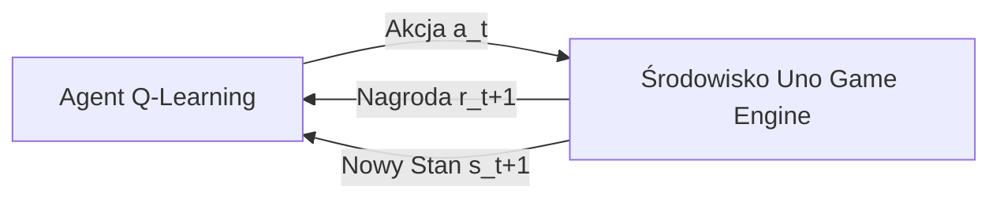

# Dokumentacja Techniczna: Uczenie ze Wzmocnieniem (`Uno/QLearning`)

## 1. Formalne Sformułowanie Problemu w Ramach MDP

Moduł `Uno/QLearning` przeznaczony jest do bezmodelowego uczenia ze wzmocnieniem (**Model-Free Reinforcement Learning**) w koncepcji **Procesów Decyzyjnych Markowa (MDP)**.

W przeciwieństwie do uczenia nadzorowanego, agent nie potrzebuje etykietowanych danych treningowych ani eksperta – uczy się optymalnej strategii polityki $\pi(a \mid s)$ wyłącznie poprzez interakcję ze środowiskiem gry i próbkowanie sygnałów nagród.

---

## 2. Równanie Bellmana i Algorytm Q-Learning

Algorytm aktualizuje szacowaną wartość oczekiwaną nagrody dla pary stan-akcja $Q(s, a)$ w oparciu o regułę Różnic Czasowych **TD(0) (Temporal Difference Learning)**:

$$Q(s_t, a_t) \leftarrow Q(s_t, a_t) + \alpha \cdot \left[ r_{t+1} + \gamma \max_{a'} Q(s_{t+1}, a') - Q(s_t, a_t) \right]$$

gdzie:
- $Q(s_t, a_t)$ – aktualna wartość funkcji $Q$ dla stanu $s_t$ i akcji $a_t$.
- $\alpha \in (0, 1]$ – współczynnik uczenia (`alpha = 0.1`), określający wagę nowej informacji.
- $r_{t+1}$ – natychmiastowa nagroda uzyskana po wykonaniu akcji $a_t$.
- $\gamma \in [0, 1)$ – współczynnik dyskontowania (`gamma = 0.9`), określający wagę przyszłych nagród.
- $\max_{a'} Q(s_{t+1}, a')$ – maksymalna szacowana wartość $Q$ dla kolejnego stanu $s_{t+1}$.

---

## 3. Hiperparametry i Strategia Eksploracji ($\epsilon$-Greedy)

Współczynnik eksploracji $\epsilon$ określa balans pomiędzy próbkowaniem nowych zagrań a eksploatacją dotychczasowej wiedzy:

$$a_t = \begin{cases} \text{losowa akcja } a \in \text{Valid}(s_t) & \text{z prawdopodobieństwem } \epsilon \\ \arg\max_{a \in \text{Valid}(s_t)} Q(s_t, a) & \text{z prawdopodobieństwem } 1 - \epsilon \end{cases}$$

Zredukowanie współczynnika eksploracji następuje po każdym epizodzie (meczu) według zależności:

$$\epsilon_{t+1} = \max(\epsilon_{min}, \epsilon_t \times \text{epsilon\_decay})$$

### Zestawienie Hiperparametrów (`QlearningBot`):
- `alpha` ($\alpha$): $0.1$
- `gamma` ($\gamma$): $0.9$
- `epsilon` ($\epsilon_{init}$): $1.0$ (startowo 100% eksploracji)
- `epsilon_decay`: $0.9999$
- `min_epsilon` ($\epsilon_{min}$): $0.01$ (minimalnie 1% losowości)
- `num_episodes`: $100\,000$ symulowanych epizodów

---

## 4. Wyzwanie Przekleństwa Wymiarowości (*Curse of Dimensionality*)

Zastosowanie tabelarycznego Q-Learningu w Uno napotyka barierę przestrzeni stanów:

1. **Eksplozja Kombinatoryczna:** Liczba unikalnych układów kart w ręce, kombinacji kart na stosie oraz liczby kart przeciwników w Uno przekracza $10^{12}$ stanów.
2. **Niewystarczalność Tabeli Q:** Tabela $Q$ nie jest w stanie pomieścić wszystkich możliwych stanów, a rzadkie odwiedzanie poszczególnych stanów uniemożliwia konwergencję wartości $Q(s, a)$.
3. **Konieczność Aproksymacji (DQN):** Rozwiązaniem tego problemu jest przejście z tabelarycznego Q-Learningu na **Deep Q-Learning (DQN)**, gdzie funkcję tabeli $Q(s, a)$ zastępuje głęboka sieć neuronowa $Q(s, a; \theta)$.
