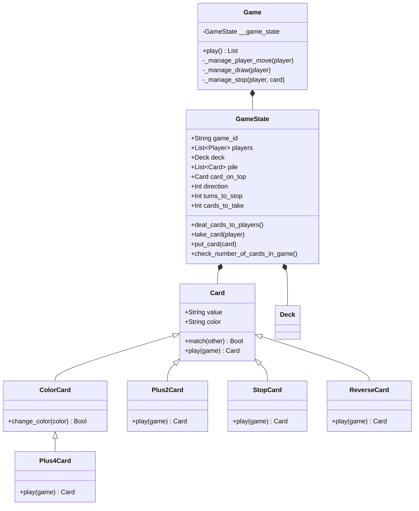

# Dokumentacja Techniczna: Silnik Gry Uno (`Uno/game`)

## 1. Formalny Model Teoretyczny Gry

Środowisko gry Uno w zaimplementowanym systemie jest formalnie zdefiniowane jako **Partially Observable Markov Decision Process (POMDP)** — Częściowo Obserwowalny Stochastyczny Proces Decyzyjny Markowa dla problemu wieloagentowego z niepełną informacją.

Formalna 6-krotka reprezentująca środowisko gry:
$$\mathcal{M} = \langle \mathcal{S}, \mathcal{A}, \mathcal{T}, \mathcal{R}, \Omega, \mathcal{O} \rangle$$

gdzie:
- $\mathcal{S}$ – ukryta, pełna przestrzeń stanów (zawierająca układy kart w rękach wszystkich graczy, sekwencję kart w zakrytej talii $D$ oraz na stosie kart odrzuconych $P$).
- $\mathcal{A}$ – przestrzeń dyskretnych akcji agenta (zagranie legalnej karty z ręki $c \in H_i$ lub akcja dociągnięcia `DrawCard`).
- $\mathcal{T}(s' \mid s, a)$ – stochastyczna funkcja przejścia stanów wynikająca ze statystycznego rozkładu dociąganych kart z zakrytej talii $D$.
- $\mathcal{R}_i(s, a)$ – skalarne wyjście funkcji nagrody (wypłata wygrana/przegrana $+1 / -1$ po zakończeniu meczu).
- $\Omega$ – przestrzeń możliwych obserwacji.
- $\mathcal{O}(o \mid s)$ – funkcja obserwacji; agent $i$ widzi jedynie własną rękę $H_i$, kartę na szczycie stosu $c_{top}$, liczbę kart pozostałych rywali $|H_j|$ oraz historię zagrań $\mathcal{H}$.

---

## 2. Architektura Klas i Inżynieria Oprogramowania

Silnik gry został zaprojektowany w oparciu o zasady programowania obiektowego (OOP) z wyraźnym rozdzieleniem logiki gry, zarządzania stanem oraz reprezentacji danych.

---

## 3. Szczegółowy Opis Komponentów

### 3.1. Hierarchia Kart (`Card.py`)

- **`Card` (Klasa Bazowa):** Reprezentuje kartę numeryczną (0-9) w czterech kolorach (`Red`, `Green`, `Blue`, `Yellow`).
  - Metoda `match(other)` określa legalność zagrania:
    $$\text{Match}(c_1, c_2) = \big(c_1.\text{value} = c_2.\text{value}\big) \lor \big(c_1.\text{color} = c_2.\text{color}\big) \lor \big(c_2.\text{color} = \text{"Colors"}\big)$$
- **`ColorCard` & `Plus4Card` (Dzikie Karty):** Dostępne bez względu na kolor karty na stosie. Pozwalają agentowi dynamicznie zmienić wiodący kolor gry na wybraną barwę ze zbioru $\{\text{Red, Green, Blue, Yellow}\}$.
- **`Plus2Card` & `Plus4Card` (Karty Kary):** Zwiększają licznik `cards_to_take` w obiekcie `GameState` odpowiednio o $+2$ lub $+4$.
- **`StopCard` (Blokada):** Modyfikuje zmienną `turns_to_stop`, powodując pominięcie tury kolejnego gracza.
- **`ReverseCard` (Zmiana Kierunku):** Odwraca zwrot wektora kolejności graczy:
  $$\text{direction} \leftarrow \text{direction} \times (-1)$$
- **Pseudokarty sterujące (`DrawCard`, `SurrenderCard`):** Obiekty reprezentujące intencje wymuszenia dociągnięcia karty lub poddania meczu przez gracza.

### 3.2. Zarządzanie Talią i Logiką Stanu (`Deck.py` & `GameState.py`)

- **Niezmiennik 108 Kart (Inwariant Systemowy):**
  W dowolnym momencie symulacji spełnione musi być równanie ciągłości masy kart w systemie:
  $$|D| + |P| + \sum_{i=1}^{N} |H_i| = 108$$
  Weryfikacja tej równości odbywa się za pomocą metody `check_number_of_cards_in_game()`. W przypadku niedomiaru wywoływany jest wyjątek `ValueError` z pełnym raportem missing-card telemetry.

- **Obsługa Braków w Talii (`move_pile_to_deck` / `reshuffle_discard_pile`):**
  Gdy $|D| \le 1$, stos kart odrzuconych $P$ (z wyłączeniem szczytowej karty $c_{top}$) jest automatycznie przetasowywany, tworząc nową zakrytą talię $D$.

### 3.3. Pętla Gry i Zarządzanie RUNDĄ (`Game.py`)

Główna pętla wykonawcza `play()` steruje przepływem tury:
1. Pobranie aktywnego gracza $p_i = \text{players}[\text{index\_of\_a\_player}]$.
2. Aktualizacja statusu zatrzymania (`player.stopped`).
3. Wywołanie `_manage_player_move(player)`:
   - Zbieranie wektora cech `extract_features()`.
   - Odczyt decyzji gracza $a = p_i.\text{move}(\text{game})$.
   - Walidacja legalności ruchu.
   - Wykonanie akcji: umieszczenie karty na stosie $P$, nałożenie efektów kart specjalnych lub dociągnięcie ze stosu $D$.
4. Sprawdzenie warunku zwycięstwa ($|H_i| = 0$).
5. Aktualizacja indeksu gracza:
   $$\text{index\_of\_a\_player} \leftarrow (\text{index\_of\_a\_player} + \text{direction}) \pmod N$$

---

## 4. Reprezentacja Stanu i Ekstrakcja Cech (*Feature Vectorization*)

Na potrzeby modeli uczenia maszynowego (C4.5, Naive Bayes, SimpleNN) silnik gry przekształca stan $s \in \mathcal{S}$ w dyskretno-ciągły wektor cech. 

Zbiór cech pozyskiwanych ze stanu gry obejmuje:
- `card_on_top_color`, `card_on_top_value` – właściwości widocznej karty na stosie.
- `num_cards_in_hand` – liczba kart aktywnego gracza.
- `avg_opponents_cards` – średnia liczba kart posiadana przez przeciwników:
  $$\text{avg\_opponents\_cards} = \frac{1}{N-1} \sum_{j \neq i} |H_j|$$
- `cards_to_take` – kumulacyjna liczba kart do dociągnięcia z tytułu akcji $+2 / +4$.
- `turns_to_stop` – stan blokady tur.
- `direction` – kierunek rozgrywki ($+1$ lub $-1$).
- `is_game_over` – flaga zakończenia rozgrywki.

Wektor ten jest zapisywany w strukturze `features_list` po każdym ruchu i stanowi podstawę zbioru treningowego dla modeli uczenia nadzorowanego.
