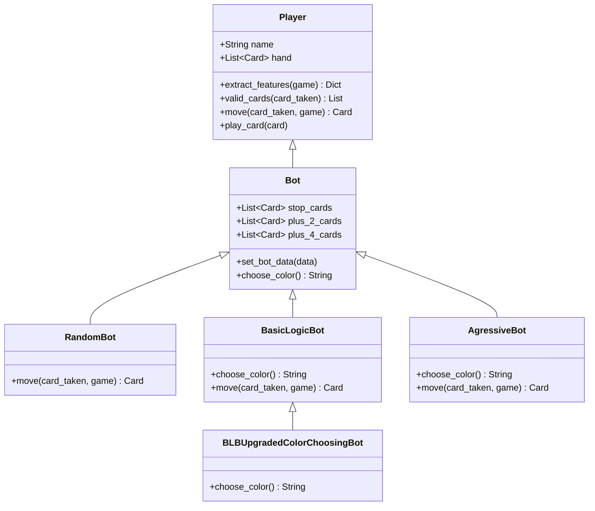

# Dokumentacja Techniczna: Boty Heurystyczne i Regułowe (`Uno/players`)

## 1. Rola Botów Heurystycznych w Eksperymentach Badawczych

W ramach przeprowadzanego projektu badawczo-inżynierskiego, grupa botów regułowych i heurystycznych pełni dwa kluczowe zadania:
1. **Punkty Odniesienia (Baselines):** Służą jako wzorce porównawcze dla oceny efektywności zaawansowanych agentów sztucznej inteligencji (C4.5, Naive Bayes, MCTS, Sieci Neuronowe).
2. **Generatory Zbioru Treningowego (Data Generators):** Symulacje rozgrywek z udziałem botów heurystycznych generują próbki historyczne cech i decyzji wykorzystywane w uczeniu nadzorowanym oraz uczeniu z naśladownictwa (*Imitation Learning*).

---

## 2. Architektura Klas i Inżynieria Interfejsu Gracza

Klasa `Player` stanowi główny interfejs wykonawczy, integrujący logikę ręki gracza, filtrowanie ruchów oraz generowanie wektora cech. Klasa `Bot` rozszerza `Player` o automatyczny mechanizm podejmowania decyzji.

---

## 3. Szczegółowy Opis Implementacyjny i Algorytmiczny

### 3.1. `RandomBot` – Stochastyczny Punkt Odniesienia

`RandomBot` realizuje najbardziej podstawową strategię decyzyjną polegającą na losowaniu legalnego ruchu z rozkładu jednostajnego:

- **Formuła Matematyczna:**
  Wyznaczenie zbioru legalnych ruchów $V(s) = \text{valid\_cards}(s)$. Decyzja $a$ podejmowana jest wg rozkładu:
  $$P(a = c) = \begin{cases} \frac{1}{|V(s)|} & \text{dla } c \in V(s) \\ 0 & \text{dla } c \notin V(s) \end{cases}$$

- **Charakterystyka:** Bot nie uwzględnia stanu gry, liczby kart przeciwnika ani wartości własnych kart. Stanowi bezstronny zerowy punkt odniesienia (*Zero-Knowledge Baseline*).

---

### 3.2. `BasicLogicBot` (BLB) – Zachłanna Heurystyka Koloru i Dopasowania

`BasicLogicBot` implementuje deterministyczno-heurystyczny zestaw reguł reagowania na sytuacje na stole:

- **Algorytm Wyboru Karty (`move`):**
  1. Reakcja na zagranie karty ataku $+2 / +4$: jeśli bot posiada w ręce odpowiadające karty $+2$ lub $+4$, zagrywa je w pierwszej kolejności, unikając dociągnięcia kary.
  2. Reakcja na kartę blokady `Stop`: zagrywa własną kartę `Stop` w celu przebicia efektu.
  3. Stan standardowy: spośród wszystkich legalnych kart w ręce wybiera losowo jedną z nich. Jeśli wymagane jest dociągnięcie, zwraca obiekt `DrawCard`.

- **Heurystyka Wyboru Koloru Dzikiej Karty (`choose_color`):**
  Gdy bot zagrywa dziką kartę (`ColorCard` lub `Plus4Card`), wybiera kolor $c^* \in \{\text{Red, Green, Blue, Yellow}\}$, którego posiada najwięcej w aktualnej ręce $H_i$:
  $$c^* = \arg\max_{c \in C} \sum_{card \in H_i} \mathbb{I}(card.color = c)$$

---

### 3.3. `BLBUpgradedColorChoosingBot` – Estymacja Statystyki Stosu

Udoskonalona wersja bota `BasicLogicBot`. Udoskonalenie polega na modyfikacji funkcji `choose_color()`. Bot uwzględnia nie tylko karty we własnej ręce, ale również rozkład kolorów kart już odrzuconych na stos $P$.

- **Wzór Estymacji Koloru:**
  $$Score(c) = \frac{\text{count}(c, P)}{|P|} + \frac{\text{count}(c, H_i)}{|H_i|}$$
  $$c^* = \arg\max_{c \in H_i \cap C} Score(c)$$

Bot wybiera kolor, który jest statystycznie najbardziej nasycony w grze i obecny w ręce, minimalizując prawdopodobieństwo, że przeciwnik posiada kontrujący kolor.

---

### 3.4. `AgressiveBot` – Heurystyka Wymuszania Ataku i Punktacji

`AgressiveBot` priorytetyzuje akcje agresywne, zmierzające do zablokowania rywala oraz pozbycia się kart o najwyższej wartości punktowej.

- **Priorytety Zagrań:**
  1. Zagrywanie kart skumulowanego ataku $+4$ oraz $+2$.
  2. Zagrywanie kart funkcyjnych `Stop` oraz `Reverse` celem odebrania tury rywalowi.
  3. Pozbywanie się kart o najwyższych wartościach numerycznych (np. 9, 8, 7), minimalizując sumaryczną wartość punktową ręki w przypadku ewentualnej przegranej.

---

## 4. Porównanie Wynikowe i Złożoność Algorytmiczna

| Bot | Złożoność Czasowa $O(\cdot)$ | Złożoność Pamięciowa $O(\cdot)$ | Zachłanność (Greediness) | Poziom Wykorzystania Informacji |
| :--- | :--- | :--- | :--- | :--- |
| **`RandomBot`** | $O(|H_i|)$ | $O(1)$ | Brak (Brak strategii) | Zero-Knowledge |
| **`BasicLogicBot`** | $O(|H_i|)$ | $O(|H_i|)$ | Niska | Pełny lokalny stan ręki |
| **`BLBUpgradedBot`** | $O(|H_i| + |P|)$ | $O(|H_i| + |P|)$ | Średnia | Lokalna ręka + Statystyka stosu odrzuconych |
| **`AgressiveBot`** | $O(|H_i| \log |H_i|)$ | $O(|H_i|)$ | Wysoka | Lokalna ręka + Priorytetyzacja kar |
